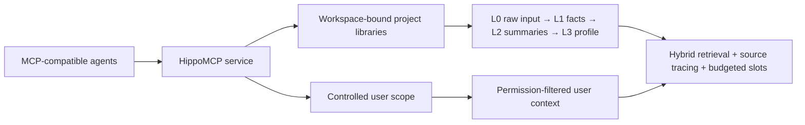

# HippoMCP

<!-- mcp-name: io.github.cstksniper/hippocampus-mcp -->

**A memory system built for AI agents.**

**English** ｜ [简体中文](https://github.com/cstksniper/hippocampus-mcp/blob/main/README.zh-CN.md)

[](https://github.com/cstksniper/hippocampus-mcp/actions/workflows/ci.yml)
[](https://pypi.org/project/hippocampus-mcp/)


HippoMCP gives AI agents a local place to **store conversations and project knowledge,
retrieve relevant facts when needed, and carry unfinished work across sessions**.
Through the [Model Context Protocol](https://modelcontextprotocol.io) (MCP), multiple agents
can use the same authorized memory libraries while keeping project and user context distinct.

It is local-first, preserves original input for traceability, and does not require an LLM API
for its core ingestion path. The host agent reasons and acts; HippoMCP provides the memory
lifecycle underneath it.

---

## Highlights

**Usable by an agent, out of the box**

- One-line install: `pip install hippocampus-mcp`, then `hippocampus-mcp install` writes the host
  config, memory hooks, and diagnostics; `hippocampus init --project .` binds a new project with
  zero manual steps.
- **Automatic memory hooks** (ZCode): per-turn context injection with cross-turn deduplication,
  a session bootstrap (pinned facts / open todos / recent sessions / unfinished topics) at every
  start and after compaction, and a wrap-up reminder — the hooks do the remembering-to-do-it, so
  the agent does not have to.
- **Adaptive result count** (default on): retrieval returns more entries when they are relevant
  and non-redundant, fewer when the pool is noisy — the count is computed, not fixed.

**原生中文 · Native Chinese support**

Chinese-first, not translated afterwards: on a Chinese system the embedding model auto-selects
BGE (768-dim); ingestion handles Chinese sentence segmentation with per-library entity lexicons;
the lexical channel handles Chinese bigrams; chapter/volume/year tags become hard filters.
Details below.

---

## What HippoMCP does

| Function | Pain it addresses | What the system provides |
|---|---|---|
| **Remember conversations and documents** | Important conclusions disappear when a session ends or its context is compacted | `ingest` stores original input in L0, extracts L1 facts, deduplicates them, and links entities; batch ingestion handles larger collections |
| **Find and assemble relevant context** | Large document sets cannot be reread every session, exact-keyword search misses paraphrases, and raw top-k results can overwhelm the prompt | Semantic + BM25 hybrid retrieval, RRF fusion, MMR, entity weighting, and five budgeted context slots through `get_memory_context` |
| **Continue long-running work** | A new session starts blank, and the agent does not know what remains unfinished | `session_start` builds a task-oriented bootstrap; its `session_id` supports compaction recovery; intents, summaries, and open topics carry work forward through `session_end` |
| **Organize and maintain memory** | A growing memory library becomes noisy, stale, or difficult to inspect | Session summaries, profiles, topic and information maps, entity profiles, domain lexicons, alias suggestions, contradiction candidates, and source-drift audits |
| **Correct and forget safely** | Wrong facts keep influencing later answers, and deleting one record can leave copies in summaries, profiles, and indexes | `active` / `superseded` / `archived` states, source tracing, cascade-safe `forget_memory`, preview-first `forget_by_query`, and tombstones against resurrection |
| **Scope, share, and export memory** | Memories become trapped inside one agent, leak between projects, or get overwritten by concurrent clients | Workspace-bound project libraries, controlled user scope, `library_whoami`, multi-host MCP access, layer-specific concurrent-save merging, and memory export |

**User memory follows the user. Project memory follows the project. Neither is trapped
inside a single agent.** Sharing requires agents to connect to the same service and library;
project and user permissions still apply.

### What HippoMCP does not claim

- It is currently a **single-machine, local-first service**, not managed cloud sync or a multi-tenant service.
- It is not an Agent-to-Agent messaging or autonomous planning framework.
- It does not provide built-in knowledge-graph reasoning or general multi-hop graph queries.
- It does not guarantee better recall or lower token use for every workload. Small, curated Markdown files can be simpler and cheaper.
- Installing the MCP server alone does not force every host to write or recall memories; the host needs the lifecycle integration below.

### Native Chinese support

HippoMCP is built Chinese-first, not translated afterwards:

- **Embedding models**: on a Chinese-language system the service auto-selects a Chinese embedding model (BGE, 768-dim); other systems get MiniLM (384-dim). Switching models is a documented three-step procedure.
- **Chinese text processing**: Chinese sentence segmentation for `ingest`, per-library Chinese entity lexicons, and a lexical (BM25/FTS5) channel that handles Chinese bigrams.
- **Structured tags**: chapter/volume/year-style hard constraints turn "what did section 43 say" from guessing into filtering.
- **Docs and evaluation**: bilingual documentation, Chinese test fixtures, and Chinese query decomposition in the evaluation tooling.

---

## Complements `AGENTS.md` and `MEMORY.md` — does not replace them

**`AGENTS.md` for rules. `MEMORY.md` for essentials. HippoMCP for deep, searchable memory.**

- **`AGENTS.md`** keeps stable instructions, workflows, and project rules.
- **`MEMORY.md`** keeps a small set of curated facts that should remain available without extra services.
- **HippoMCP** adds large-scale history, cross-document retrieval, source tracing, correction,
  user-level context, and multi-agent continuity.

Your Markdown files remain the lightweight fallback. For file-backed sources, documents can
remain canonical while HippoMCP provides a derived memory and retrieval layer; `drift_audit`
compares recorded source signatures with current files. Conversation-only memories instead
trace back to HippoMCP's own L0 raw log.

For large corpora, selective retrieval **can reduce** context use by avoiding repeated whole-file
reads. Tool schemas, bootstrap packages, and retrieval results still consume tokens, and retrieval
can miss relevant evidence. HippoMCP avoids whole-file context truncation; it does not eliminate
per-item, model, or output-budget limits.

---

## Ask your agent

Agent-assisted selection works best when the agent is asked to verify claims, not just repeat them.

<details>
<summary><strong>Prompt: help me choose a memory system</strong></summary>

```text
Compare HippoMCP (https://github.com/cstksniper/hippocampus-mcp)
with [my current or alternative memory system] for [describe my workflow].

Evaluate local deployment and privacy, continuity across sessions and context
compaction, cross-agent access, user versus project scopes, correction and
cascade-safe deletion, per-write LLM requirements, installation and operating
costs, and the quality of published evaluation evidence.

Read the repository's docs/SELECTION.md, docs/INTEGRATION.md, docs/PRIVACY.md,
docs/BENCHMARKS.md, pyproject.toml, examples/, and relevant tests as well as
the README. Cite sources and mark anything you cannot verify as unknown. Do not
install anything or change my configuration. Give me a recommendation with
trade-offs, then let me decide.
```
</details>

<details>
<summary><strong>Prompt: install and verify HippoMCP for me</strong></summary>

```text
Install HippoMCP for my current MCP host. First check that Python is 3.11 or newer.

Use the installation command in the README. Then run:
1. hippocampus-mcp models --fetch
2. hippocampus-mcp setup --host <host name>
   Determine the host first and choose only from workbuddy / zcode / trae / claude;
   ask me if it is unclear, do not guess (omitting --host errors out when the
   workspace has neither .zcode/ nor .mcp.json).

Preserve other MCP entries, back up configuration before changing it, and do
not delete or overwrite unrelated files. Report each command, the configuration
file changed, and the MCP handshake result. If a step fails, show the complete
error instead of guessing. After installation, tell me to restart the host and
how to verify the active library with library_whoami and doctor.
```
</details>

---

## Quick start

### Try it from source

Requirements: **Python 3.11+** and Git.

```bash
git clone https://github.com/cstksniper/hippocampus-mcp.git
cd hippocampus-mcp
python -m pip install -e .
python examples/quickstart.py
```

The example runs **write → recall → five-slot assembly → cascade delete** using a hash
embedder. It downloads no embedding model and needs no API key. It is a pipeline smoke test,
not a demonstration of semantic retrieval quality.

> The core install is **torch-free**: the default path is the ONNX embedder + the numpy
> CfC LNN (~150 MB of dependencies, a few minutes on a typical connection). Torch and the
> sentence-transformers backend are an optional extra — `python -m pip install -e ".[torch]"` —
> ~600 MB more; you only need it if you prefer that embedder backend or the torch-CfC branch.
> When installing the extra, prefer the CPU wheel index
> (`--index-url https://download.pytorch.org/whl/cpu`); `uv` users get that pin from
> `pyproject.toml` automatically.

To try real semantic retrieval with the English MiniLM model (~90 MB on first download):

```bash
python examples/quickstart.py --model sentence-transformers/all-MiniLM-L6-v2
```

### Install into an MCP host

Install from PyPI (recommended):

```bash
python -m pip install hippocampus-mcp
hippocampus-mcp models --fetch
hippocampus-mcp install   # or: hippocampus-mcp setup --host zcode
```

> The core install is torch-free (~150 MB of dependencies). The first model fetch
> downloads the embedding model (90–390 MB depending on locale), and the first
> recall after a cold start takes tens of seconds while the model loads — both are
> one-time costs.
>
> China mirrors lag new releases; if pip cannot find the package, retry with the
> official index: `python -m pip install hippocampus-mcp -i https://pypi.org/simple`

Or install directly from GitHub:

```bash
python -m pip install "git+https://github.com/cstksniper/hippocampus-mcp.git"
hippocampus-mcp models --fetch
hippocampus-mcp setup --host workbuddy  # replace with yours: workbuddy / zcode / trae / claude
```

`setup` backs up before writing, refuses to overwrite corrupt JSON, changes only its own MCP
entry, and performs a real MCP handshake. `claude` refers to **Claude Desktop**; Claude Code,
Cursor, and other MCP hosts require separate manual configuration rather than this one-command
setup path.

Without `--host`, setup only guesses from an existing `.zcode/` or `.mcp.json` in the workspace
and **exits with an error** when neither exists. Always pass `--host` explicitly for a fresh
workspace, TRAE, or Claude Desktop so the config lands in the right file.

Then **restart the host** and start a new session. Verify the active library and configuration:

```bash
python -m hippocampus_mcp.cli doctor --host zcode --project .
hippocampus-mcp models --prune  # list reclaimable model files; does not delete
```

In the new session, call `library_whoami`. If no `mcp__hippocampus__*` tools appear, run the
module-form `doctor` command above, fix the reported issue, and restart again.

---

## Give your agent the operating rules

HippoMCP supplies memory tools; the host agent decides when to call them. Add rules like these
to your project's `AGENTS.md` or host instructions:

> On ZCode, `hippocampus-mcp install` also sets up automatic memory hooks (per-turn injection,
> session bootstrap, wrap-up reminder), which enforce the first three rules mechanically. The
> rules below remain the portable baseline for every other host. An optional observation-capture
> lane (`hippocampus-mcp install --stop-capture`) archives response highlights for later review;
> it is **off by default** and never writes to formal memory by itself.

```text
At the start of a task, call session_start with the current task and working files.
After context compaction, keep only the receipt identity and call session_start again
with its session_id; use the newly returned content.
Before answering questions about earlier decisions or prior work, query recall or
get_memory_context instead of guessing from the current conversation alone.
Use get_memory_context when you need budgeted, assembled context.
Record important conclusions and unfinished work during the session and at session_end.
Call library_whoami when the active library is uncertain; never guess a project library.
Keep AGENTS.md and MEMORY.md as the lightweight fallback. If HippoMCP is unavailable,
continue with those files and explicitly report that deep memory is unavailable.
```

Recommended lifecycle:

```text
session_start(task)            → task-relevant memories, recent state, open topics, and more
ingest(conversation)           → L0 original input + L1 extracted facts + entity links
get_memory_context(query)      → five budgeted context slots
session_end(summary, topics)   → session summary + profile consolidation + open topics
forget_memory(id, reason)      → cascade deletion across derived copies
```

---

## How it works



| Capability | Detail |
|---|---|
| Layered memory | L0 raw / L1 facts / L2 summaries / L3 profile, plus topic and information-map layers |
| Source tracing | L1 facts point to L0 through `source_ids`; file-backed sources can also be checked for drift |
| Fact state machine | `active` / `superseded` / `archived`; replaced facts remain inspectable but leave default recall |
| Retrieval | Hybrid vector + BM25 (RRF) + MMR + entity weighting + a hard relevance floor, with adaptive result count (returns more when entries are relevant and non-redundant) |
| Context assembly | `get_memory_context` provides five slots with independent budgets; `session_start` provides a broader bootstrap package |
| Domain vocabulary | Entity lexicons, alias suggestions, and entity relinking for project-specific names and identifiers |
| Tool surface | 46 MCP tools with profiles; the default profile exposes 10 (8 tools + 2 meta-dispatchers), descriptions cut from 8.3k to 3.4k characters |

See [the architecture guide](https://github.com/cstksniper/hippocampus-mcp/blob/main/docs/ARCHITECTURE.md)
for layers, flows, scoring formulas, and engineering constraints.

---

## Evaluation and evidence

Dataset: LoCoMo `locomo10` ｜ Pluggable LLM-as-judge through `JUDGE_BASE_URL` /
`JUDGE_API_KEY` / `JUDGE_MODEL`.

The **latest measured baseline** is **F1 = 0.244 ± 0.034** over three runs
(judge `glm-5.3-flash`, 50 QA from `locomo10`). Judge-environment variation was 0.068,
so small configuration deltas are not meaningful. This 50-question setup is not directly
comparable with published protocols using approximately 1,540 questions.

The historical driver that produced these measurements is not currently published. Treat this
as a measurement record with stated conditions, **not a one-command reproduction claim**.

The primary correctness claims are instead covered by executable tests: cascade-safe deletion,
superseded facts, concurrent-save merging, workspace binding, and cross-library isolation.

```bash
python scripts/run_all_tests.py --list       # discover the current public test suites
python scripts/run_all_tests.py -k forget    # run deletion-related suites
python scripts/run_all_tests.py              # full regression run
```

---

## Tool surface and advanced operations

The full service exposes 46 MCP tools across writing, reading, session lifecycle, correction,
entities, topic layers, information maps, consolidation, administration, and multi-library use.
The default profile exposes only 12 high-frequency tools; hidden tools remain available through
`hippo_help` and `hippo_extra`. Set `HIPPOCAMPUS_TOOL_PROFILE=full` to expose the full surface.

### Maintenance commands

| Command | Purpose |
|---|---|
| `hippocampus-mcp doctor` | Health check for the installation and libraries |
| `hippocampus-mcp tree` | Read-only library tree: markdown overview, or a single-file HTML viewer with `--html --out`; run inside a bound workspace it locates the library automatically |
| `hippocampus-mcp models` / `--fetch` / `--prune` | Inspect, download, and reclaim embedding-model caches |
| `python scripts/reembed.py --all` | Backfill vectors after switching the embedding model |
| `python scripts/import_md.py --dir <md dir> --project <name>` | Bulk-import Markdown documentation into a library |

See [`docs/INTEGRATION.md`](https://github.com/cstksniper/hippocampus-mcp/blob/main/docs/INTEGRATION.md)
section 10 for model selection rules and the full switching procedure.

See the dedicated guides for deeper evaluation and operation:

| Document | Contents |
|---|---|
| [`docs/SELECTION.md`](https://github.com/cstksniper/hippocampus-mcp/blob/main/docs/SELECTION.md) | Fit, non-goals, and verification checklist |
| [`docs/INTEGRATION.md`](https://github.com/cstksniper/hippocampus-mcp/blob/main/docs/INTEGRATION.md) | Host setup, model selection, lifecycle, compaction recovery, and fallback |
| [`docs/PRIVACY.md`](https://github.com/cstksniper/hippocampus-mcp/blob/main/docs/PRIVACY.md) | Storage, network, user scope, and deletion |
| [`docs/BENCHMARKS.md`](https://github.com/cstksniper/hippocampus-mcp/blob/main/docs/BENCHMARKS.md) | Current measurement conditions and limits |

## Contributing

Issues and PRs are welcome. Read section 8 of
[`docs/ARCHITECTURE.md`](https://github.com/cstksniper/hippocampus-mcp/blob/main/docs/ARCHITECTURE.md)
before changing retrieval; each engineering constraint corresponds to a real failure.

See [`CONTRIBUTING.md`](https://github.com/cstksniper/hippocampus-mcp/blob/main/CONTRIBUTING.md)
and [`CODE_OF_CONDUCT.md`](https://github.com/cstksniper/hippocampus-mcp/blob/main/CODE_OF_CONDUCT.md).

## Contact

Maintainer: **cstksniper** — [cstksniper@qq.com](mailto:cstksniper@qq.com)

Please use GitHub Issues for bugs and feature requests so the answers remain searchable.
Email is for security reports, private data, or collaboration that does not belong in public.

## License

MIT — see [`LICENSE`](https://github.com/cstksniper/hippocampus-mcp/blob/main/LICENSE).
