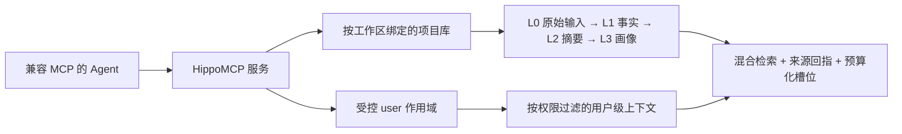

# HippoMCP

**为 AI Agent 而生的记忆体。**

**简体中文** ｜ [English](https://github.com/cstksniper/hippocampus-mcp/blob/main/README.md)

[](https://github.com/cstksniper/hippocampus-mcp/actions/workflows/ci.yml)
[](https://pypi.org/project/hippocampus-mcp/)


HippoMCP 为 AI Agent 提供一个本地记忆系统，用来**保存对话与项目知识、在需要时找回相关事实，
并让未完结工作跨会话延续**。通过 [Model Context Protocol](https://modelcontextprotocol.io)
（MCP），多个 Agent 可以使用同一批获授权的记忆库，同时保持项目与用户上下文的边界。

它采用本地优先设计，保留原始输入以便溯源，核心写入路径不依赖 LLM API。
宿主 Agent 负责推理和行动，HippoMCP 提供其底层的记忆生命周期。

---

## 核心亮点

**对 Agent 开箱即用**

- 一行安装：`pip install hippocampus-mcp`，再执行 `hippocampus-mcp install` 即写入宿主配置、
  记忆钩子与诊断；`hippocampus-mcp init --project .` 让新项目零手工步骤完成绑定。
- **自动记忆钩子**（ZCode）：每轮上下文自动注入（带跨轮去重）、每次开场与压缩后的
  开场锚点（钉住事实 / 待办 / 近期会话 / 未完结话题）、收尾提醒——"记得去做"由钩子承担，
  不依赖 Agent 自觉。
- **自适应召回条数**（默认开）：相关且不重复时多给，噪声池少给——条数是算出来的，不是写死的。

**原生中文支持**

中文优先而非事后翻译：中文系统自动选用 BGE 嵌入模型（768 维）；`ingest` 支持中文分句与
按库实体词表；字面通道处理中文二元组；章/卷/年标签成为硬过滤条件。详见下文。

---

## HippoMCP 的主要功能

| 功能 | 解决的痛点 | 系统提供的具体能力 |
|---|---|---|
| **记住对话与文档** | 会话结束或上下文压缩后，重要结论随之消失 | `ingest` 把原始输入写入 L0、萃取 L1 事实、去重并关联实体；`ingest_batch` 支持批量资料导入 |
| **找到并装配相关上下文** | 文档太多无法每次整读；grep 依赖准确关键词；top-k 平铺又容易塞入噪声 | 语义 + BM25 混合检索、RRF 融合、MMR、实体加权，以及 `get_memory_context` 的五个预算化上下文槽位 |
| **延续长周期任务** | 新会话从零开始，Agent 不知道上次做到哪、还有什么没完成 | `session_start` 生成任务导向开场包，凭 `session_id` 支持压缩恢复；意图、摘要和未完结话题通过 `session_end` 延续 |
| **整理并维护记忆** | 记忆越来越多后，出现噪声、过期、专名难查和状态难核对 | 会话摘要、画像、主题与信息地图、实体档案、领域词库、别名候选、矛盾候选和源文件漂移审计 |
| **安全地纠错与遗忘** | 错误事实持续影响后续回答；只删一条记录，摘要、画像和索引里仍可能保留副本 | `active` / `superseded` / `archived` 状态机、原文溯源、级联 `forget_memory`、默认预览的 `forget_by_query`，以及防复活墓碑 |
| **隔离、共享并导出记忆** | 记忆被锁在某个 Agent 中、不同项目互相污染，或多个客户端并发覆盖 | 工作区项目库、受控 user 作用域、`library_whoami`、多宿主 MCP 访问、分层并发合并和记忆导出 |

**用户记忆跟随用户，项目记忆跟随项目，都不被锁死在某个 Agent 里。**
共享的前提是多个 Agent 连接同一服务和相应记忆库，项目与 user 权限边界仍然有效。

### 能力边界

- 当前是**单机、本地优先服务**，不是托管云同步或多租户服务。
- 不是 Agent-to-Agent 消息通信或自主规划框架。
- 不提供内建知识图谱推理或通用多跳图查询。
- 不承诺所有任务都召回更准或更省 token；小而精的 Markdown 文件可能更简单、更便宜。
- 只安装 MCP server 并不会迫使宿主自动写入和召回；还需要下文的会话生命周期接入规则。

### 原生中文支持

HippoMCP 是中文原生构建，而不是事后翻译：

- **嵌入模型**：中文系统自动选型中文嵌入模型（BGE，768 维），其余系统用 MiniLM（384 维）；换模型是文档化的三步流程。
- **中文文本处理**：`ingest` 的中文分句、按库配置的中文实体词表、以及能处理中文二元词的字面（BM25/FTS5）通道。
- **结构化标签**：章/卷/年式硬约束让「第 43 章说过什么」从猜变成查。
- **文档与评测**：双语文档、中文测试夹具、评测工具链中的中文查询分解。

---

## 补充 `AGENTS.md` / `MEMORY.md`，而不是替代

**`AGENTS.md` 管规则，`MEMORY.md` 管核心保底记忆，HippoMCP 管深层可检索记忆。**

- **`AGENTS.md`**：稳定指令、工作流和项目约束。
- **`MEMORY.md`**：少量人工精选、没有额外服务也不能丢的核心事实。
- **HippoMCP**：大规模历史、跨文档检索、来源回指、纠错、用户级上下文和多 Agent 连续性。

Markdown 文件始终是轻量 fallback。对文件背书的语料，源文档可以继续作为真相源，HippoMCP
提供派生记忆与检索层；`drift_audit` 对比记录的源文件签名与当前文件。纯对话记忆则回指
HippoMCP 自己的 L0 原始日志。

对大语料，按需检索**可以减少**反复整读造成的上下文消耗；但工具 schema、开场包和检索结果
仍消耗 token，检索也可能漏掉证据。HippoMCP 避免的是整文件上上下文造成的截断，并不消除
单条内容、模型或输出预算限制。

---

## 交给你的 Agent

Agent 辅助选型的关键不是复述宣传，而是核查证据、说明取舍。

<details>
<summary><strong>提示词：帮我选择合适的记忆系统</strong></summary>

```text
请比较 HippoMCP（https://github.com/cstksniper/hippocampus-mcp）
与 [我当前或备选的记忆系统] 是否适合 [描述我的工作流]。

比较本地部署与隐私、跨会话和上下文压缩后的连续性、跨 Agent 使用、
用户级与项目级隔离、纠错与级联删除、写入是否调用 LLM、安装运维成本，
以及公开评测证据的质量与限制。

除 README 外，请阅读 docs/SELECTION.md、docs/INTEGRATION.md、docs/PRIVACY.md、
docs/BENCHMARKS.md、pyproject.toml、examples/ 和相关 tests。引用信息来源，
无法核实的项目明确写“未知”。不要安装任何东西，也不要修改配置。
给出带取舍的建议，最后由我决定。
```
</details>

<details>
<summary><strong>提示词：帮我安装并验证 HippoMCP</strong></summary>

```text
请为当前 MCP 宿主安装 HippoMCP。先检查 Python 是否为 3.11 或更新版本。

按 README 的安装命令执行。然后运行：
1. hippocampus-mcp models --fetch
2. hippocampus-mcp setup --host <宿主名>
   先确认当前宿主，只能从 workbuddy / zcode / trae / claude 中选；
   无法确定就问我，不要猜测（不填 --host 时，工作区没有 .zcode/ 或 .mcp.json 会直接报错）。

保留其他 MCP 条目，修改配置前备份，不删除或覆盖无关文件。
报告每条命令、实际修改的配置文件和 MCP 握手结果。
任何一步失败都贴出完整报错，不要猜着改配置。
安装后告诉我需要重启宿主，以及如何用 library_whoami 和 doctor 验证落点。
```
</details>

---

## 快速开始

### 从源码试跑

要求：**Python 3.11+** 和 Git。

```bash
git clone https://github.com/cstksniper/hippocampus-mcp.git
cd hippocampus-mcp
python -m pip install -e .
python examples/quickstart.py
```

示例使用哈希嵌入跑通 **写入 → 召回 → 五槽装配 → 级联删除**，不下载嵌入模型、不需要
API Key。它用于验证管线，不用于证明语义检索质量。

> 不下载模型**不等于零依赖**。安装会拉取 `pyproject.toml` 声明的依赖，包括
> `torch`、`numpy` 和 `mcp`。
>
> 想避免下载几 GB 的 CUDA 版 torch，把上面的 `python -m pip install -e .` 换成下面两条：
>
> ```bash
> python -m pip install "torch>=2.0,<3" --index-url https://download.pytorch.org/whl/cpu
> python -m pip install -e .
> ```
>
> 用 `uv` 时无需这一步，`pyproject.toml` 已配置 CPU 源。

要试真实语义检索，可指定英文 MiniLM 模型（首次下载约 90 MB）：

```bash
python examples/quickstart.py --model sentence-transformers/all-MiniLM-L6-v2
```

### 安装到 MCP 宿主

直接从 GitHub 安装：

```bash
python -m pip install "git+https://github.com/cstksniper/hippocampus-mcp.git"
hippocampus-mcp models --fetch
hippocampus-mcp setup --host workbuddy  # 换成你的宿主：workbuddy / zcode / trae / claude
```

`setup` 写前备份，既有 JSON 损坏时停止覆盖，只修改自己的 MCP 条目，并在写后执行真实
MCP 握手。`claude` 指 **Claude Desktop**；Claude Code、Cursor 和其他 MCP 宿主需要单独
手工配置，不属于这条一键 setup 路径。

不填 `--host` 时，只能按工作区里已有的 `.zcode/` 或 `.mcp.json` 猜宿主，**猜不出会直接报错**
并要求显式指定。全新工作区、TRAE、Claude Desktop 建议一律显式填 `--host`，避免写错配置文件。

然后**重启宿主并新建会话**。检查配置与落点：

```bash
python -m hippocampus_mcp.cli doctor --host zcode --project .
hippocampus-mcp models --prune  # 只列可回收模型文件，不删除
```

在新会话调用 `library_whoami`。如果没有出现 `mcp__hippocampus__*` 工具，运行上面的
模块版 `doctor`，按结论修复并再次重启。

---

## 给 Agent 的使用规则

HippoMCP 提供记忆工具，宿主 Agent 决定何时调用。可以把以下规则加入项目的
`AGENTS.md` 或宿主指令：

> 在 ZCode 上，`hippocampus-mcp install` 还会安装自动记忆钩子（每轮注入、开场锚点、
> 收尾提醒），前三条规则由机制强制执行；以下规则仍是所有其他宿主的通用基线。
> 可选的观察捕获 lane（`hippocampus-mcp install --stop-capture`）会把响应要点归档
> 供事后整理，**默认关闭**，且自身绝不写入正式记忆。

```text
任务开始时，带当前任务和正在修改的文件调用 session_start。
上下文压缩后，只保留 receipt 的身份信息，凭其中的 session_id 再调 session_start，
以本次重新返回的内容为准。
回答既往决策或历史工作前，先调用 recall 或 get_memory_context，
不要只凭当前对话猜测。需要预算化装配上下文时使用 get_memory_context。
会话中记录关键结论和未完结工作，结束时调用 session_end。
不确定当前库时先调用 library_whoami，绝不猜测项目库。
始终保留 AGENTS.md 和 MEMORY.md 作为轻量 fallback。
HippoMCP 不可用时继续使用这些文件，并明确说明深层记忆不可用。
```

推荐生命周期：

```text
session_start(task)            → 任务预召回、最近状态、未完结话题等开场内容
ingest(conversation)           → L0 原始输入 + L1 萃取事实 + 实体链接
get_memory_context(query)      → 五个带独立预算的上下文槽位
session_end(summary, topics)   → 会话摘要 + 画像巩固 + 未完结话题
forget_memory(id, reason)      → 级联删除派生副本
```

---

## 工作方式



| 能力 | 说明 |
|---|---|
| 记忆分层 | L0 原始 / L1 事实 / L2 摘要 / L3 画像，另有主题层与信息地图层 |
| 来源回指 | L1 用 `source_ids` 回指 L0；文件背书来源还可做漂移审计 |
| 事实状态机 | `active` / `superseded` / `archived`；旧事实可检查，但默认退出召回 |
| 检索 | 向量 + BM25（RRF）混合 + MMR + 实体加权 + 相关性硬门槛，并带自适应召回条数（相关且不重复时多给） |
| 上下文装配 | `get_memory_context` 提供五个独立预算槽位；`session_start` 提供更完整的开场包 |
| 领域词表 | 实体词库、别名候选和实体 relink，适配项目专名、别名与编号 |
| 工具面 | 46 个 MCP 工具，按剖面裁剪；默认暴露 10 个（8 工具 + 2 派发器），描述总量从 8.3k 字符精简至 3.4k |

分层、流程、评分公式和工程约束见
[架构文档](https://github.com/cstksniper/hippocampus-mcp/blob/main/docs/ARCHITECTURE.zh-CN.md)。

---

## 评测与证据

数据集：LoCoMo `locomo10` ｜ 通过 `JUDGE_BASE_URL` / `JUDGE_API_KEY` / `JUDGE_MODEL`
接入可插拔 LLM judge。

**最近一次测量基线**为 **F1 = 0.244 ± 0.034**，共跑 3 次
（judge `glm-5.3-flash`，`locomo10` 的 50 道 QA）。judge 环境自身变化为 0.068，
因此小幅配置差异没有意义。这个 50 题口径不能与约 1,540 题的公开协议直接比较。

产生这些测量值的历史驱动脚本目前未公开。因此它是注明条件的**测量记录**，不是
“一条命令即可复现”的承诺。

项目的主要正确性承诺由可执行测试支撑：级联删除、superseded、并发保存合并、工作区绑定
和跨库隔离。

```bash
python scripts/run_all_tests.py --list       # 列出当前公开测试套件
python scripts/run_all_tests.py -k forget    # 运行删除相关套件
python scripts/run_all_tests.py              # 全量回归
```

---

## 进阶参考

<details>
<summary><strong>宿主手工配置、同步与模型维护</strong></summary>

### 宿主配置文件

| 宿主 | 配置文件 | 一键 setup |
|---|---|---|
| WorkBuddy | `<workspace>/.mcp.json`，否则 `~/.workbuddy/mcp.json` | `--host workbuddy` |
| ZCode | `<workspace>/.zcode/config.json`（不是 `.mcp.json`） | `--host zcode` |
| TRAE | `%APPDATA%\TRAE SOLO CN\User\mcp.json` | `--host trae` |
| Claude Desktop | `%APPDATA%\Claude\claude_desktop_config.json` | `--host claude` |

生产入口为 `python -m hippocampus_mcp.launcher`：多宿主、多会话可共享单份 daemon 和嵌入模型。
launcher 异常时回退直连；`HIPPOCAMPUS_LAUNCHER=0` 可显式关闭 launcher。

### WorkBuddy 手工示例

键名为 `mcpServers`：

```json
{
  "mcpServers": {
    "hippocampus": {
      "command": "/absolute/path/to/python",
      "args": ["-m", "hippocampus_mcp.launcher"],
      "env": {
        "HIPPOCAMPUS_PERSIST_DIR": "/absolute/path/to/data/brain",
        "HIPPOCAMPUS_EMB_MODEL": "BAAI/bge-base-zh-v1.5",
        "HIPPOCAMPUS_TOOL_PROFILE": "common"
      }
    }
  }
}
```

### ZCode 手工示例

键名是嵌套的 `mcp` → `servers`：

```json
{
  "mcp": {
    "servers": {
      "hippocampus": {
        "command": "/absolute/path/to/python",
        "args": ["-m", "hippocampus_mcp.launcher"],
        "env": {
          "HIPPOCAMPUS_PERSIST_DIR": "/absolute/path/to/data/brain",
          "HIPPOCAMPUS_EMB_MODEL": "BAAI/bge-base-zh-v1.5"
        }
      }
    }
  }
}
```

TRAE 使用 `mcpServers`，但其工作目录可能是用户主目录而非项目目录，因此库路径必须写绝对路径；
新会话先用 `library_whoami` 确认。中文语料建议显式使用 `BAAI/bge-base-zh-v1.5`，
英文基线为 `all-MiniLM-L6-v2`。首次安装不要设 `HF_HUB_OFFLINE=1`，否则无法下载模型。

### 多宿主同步

```bash
hippocampus-mcp sync            # 预览已存在的宿主配置
hippocampus-mcp sync --yes      # 确认后写入；逐文件备份、只动自己的条目
hippocampus-mcp doctor          # 检查各宿主库指向
```

`sync` 通过文件名约定与形态嗅探发现**已存在**的配置，默认只预览，不新建文件。
认识的四家宿主优先使用 `setup`。

### 模型检查与回收

```bash
hippocampus-mcp models
hippocampus-mcp models --fetch
hippocampus-mcp models --prune        # 只预览
hippocampus-mcp models --prune --yes  # 只删已判定冗余的文件
```

中文 BGE 模型目录可能同时包含权重、ONNX 快路径和运行时不读的量化导出中间产物。
回收前先用 `--prune` 阅读保留原因；若要保留 ONNX 快路径，不要只看目录体积删除。
英文 MiniLM 主要用于英文语料与评测。

### 库状态树（tree）

```bash
hippocampus-mcp tree --full --html --out tree.html  # 单文件 HTML viewer（在绑定过的工作区里跑会自动定位库）
hippocampus-mcp tree --state all                    # markdown 总览（含 superseded/archived）
```

只读命令（sqlite 以 `mode=ro` 打开，对活库安全）。省略 `--persist-dir` 时按用户级任务目录反查当前工作区绑定的库。默认不带 `--full` 是 60 字符预览的纯预览导出（页头有提示）；`--full` 才嵌全文——导出文件包含库内容，落点自行指定。用户级库默认零正文且拒绝 `--full`。

### 看不到 MCP 工具时

```bash
python -m hippocampus_mcp.cli doctor --host zcode --project .
```

优先使用模块版 `doctor`：早期 `hippocampus-mcp.exe` 入口可能静默吞掉子命令。
修复后必须重启宿主或会话，因为旧会话的工具表已经冻结。
</details>

<details>
<summary><strong>完整工具面、多库与用户级库</strong></summary>

### 46 个 MCP 工具

| 分组 | 工具 |
|---|---|
| 写 | `ingest`、`ingest_batch`、`store_memory`、`update_memory`、`update_tags` |
| 读 | `get_memory_context`、`recall`、`get_memory`、`list_memories`、`list_sources`、`export_memories` |
| 生命周期 | `session_start`、`session_end`、`remember_intent`、`complete_intent`、`report_feedback` |
| 纠错 | `forget_memory`、`forget_by_query` |
| 实体 / 词库 | `entity_profile`、`entity_list`、`lexicon_add`、`lexicon_suggest`、`lexicon_alias_suggest`、`relink_entities` |
| 知识主题层 | `knowledge_map`、`knowledge_topic` |
| 信息地图层 | `map_set`、`map_get`、`map_list`、`map_verify` |
| 巩固 / 诊断 | `consolidate`、`contradictions`、`drift_audit`、`brain_stats`、`get_stats`、`miss_log` |
| 管理 | `reset_context`、`save_state`、`save_brain`、`load_state`、`retry_save` |
| 多库 | `library_list`、`library_info`、`library_whoami`、`library_use`、`library_create` |

默认 common 剖面注册高频 10 条加 `hippo_help` / `hippo_extra`，共 12 个可见工具，
约 4.7k token。隐藏工具可通过 `hippo_help` 查目录，再用
`hippo_extra(action="名字", args='{...}')` 调用。`HIPPOCAMPUS_TOOL_PROFILE=full`
注册全量 46 个，约 14.4k token；另有 core / writer / lexicon / entity / admin / map / minimal。
完整参数以真实 MCP `tools/list` 和工具 docstring 为准。

### 多库

```text
library_list()          # 查看可用库
library_use("项目名")   # 显式切换当前会话的库
library_whoami()        # 自报当前落点
```

显式 `library=` 可单次覆盖，会话粘性和工作区默认绑定负责后续解析。
无法解析、命中备份目录或存在重名歧义时应显式报错，不应悄悄改道其他库。
每次写入返回体首键为 `library`，用于检查是否写错落点。

### 用户级库与待审队列

日常助手可以把家库直接设为 `user`，保存长期用户偏好与事实；项目工作区的家库通常是项目库，
用户级上下文通过 `user_scope` 继承。**home library 不恒等于 user library。**

- 非家工作区直写 user 库默认进入待审队列，返回 `quarantined: true`，不进召回池和 `user_scope`。
- 家库为 user 的日常助手写自己家，行为不变。
- 待审卡带 `sensitivity` 标签；`drift_audit` 附待审区与 `access_log` 尾窗。
- `update_memory(memory_id=…, clear_quarantine=True)` 只对家库会话开放。
- 删除仍走 `forget_memory` 级联；运维逃生门为 `HIPPOCAMPUS_CROSS_LIBRARY_WRITE=1`。
</details>

<details>
<summary><strong>当前评测、数据集与限制</strong></summary>

### 当前测量口径

当前结果为 `locomo10` 的 50 道 QA 上三次测量的 F1 = 0.244 ± 0.034。
不同 judge 可能给出不同结果，跨项目比较必须固定数据、题量、协议和 judge。
Mem0、Zep 等方案与 HippoMCP 的接入和能力边界不同，没有同口径实验时不提供逐项分数对照。
产生测量值的历史驱动脚本目前未公开，因此这里只陈述当前测量结果，不宣称一条命令即可复现。

### 数据集

公开层包含加载器与指标实现，不附带数据集本身，也不包含产生上表的历史评测驱动脚本。

| 数据集 | 获取 | 许可证 |
|---|---|---|
| LoCoMo | [snap-research/locomo](https://github.com/snap-research/locomo) 的 `data/locomo10.json` | CC BY-NC 4.0，不随仓再分发 |
| LongMemEval | HuggingFace [`xiaowu0162/longmemeval-cleaned`](https://huggingface.co/datasets/xiaowu0162/longmemeval-cleaned) | MIT，建议从官方源获取 |

judge 通过 `JUDGE_BASE_URL` / `JUDGE_API_KEY` / `JUDGE_MODEL` 接入 OpenAI 兼容
`/chat/completions` 端点；核心记忆服务不依赖 judge。接入边界见
[`scripts/judge_client.py`](https://github.com/cstksniper/hippocampus-mcp/blob/main/scripts/judge_client.py)。
</details>

<details>
<summary><strong>环境变量与回归测试</strong></summary>

### 常用环境变量

变量从进程环境读取，可写在宿主配置的 `env` 块；模板见
[`.env.example`](https://github.com/cstksniper/hippocampus-mcp/blob/main/.env.example)。

| 变量 | 默认 | 说明 |
|---|---|---|
| `HIPPOCAMPUS_PERSIST_DIR` | `~/.hippocampus_mcp` | 记忆持久化目录 |
| `HIPPOCAMPUS_EMB_MODEL` | 按系统语言自动 | 中文系统默认 BGE，其他语言默认 MiniLM；已有库跟随库内模型 |
| `HIPPOCAMPUS_EMB_MODEL_AUTO` | `1` | 设为 0 可关闭按语言自动选型 |
| `HIPPOCAMPUS_LONG_CONTENT` | `warn` | 超长内容：`warn` 自曝、`split` 拆卡、`reject` 拒写 |
| `HIPPOCAMPUS_WARMUP` | `auto` | `auto` / `off` / `sync` |
| `HIPPOCAMPUS_WARMUP_TIMEOUT` | `90` | 预热超时秒数 |
| `HIPPOCAMPUS_LAMBDA_DECAY` | `7776000` | 时间衰减常数，默认 90 天 |
| `HIPPOCAMPUS_MULTI_WRITER` | `1` | 0 = 跨进程冲突时报错 |
| `HIPPOCAMPUS_TAG_SCHEMA` | 空 | 结构化标签 schema 路径 |
| `HIPPOCAMPUS_LIBRARY_ROOTS` | `~/.hippocampus_mcp` + `<repo>/data` | 多库扫描根，`os.pathsep` 分隔 |
| `HIPPOCAMPUS_MAX_RESIDENT_LIBS` | `2` | 同时驻留库数量 |
| `HIPPOCAMPUS_LIBRARY_CACHE_TTL` | `30` | 库清单缓存秒数 |
| `OPENBLAS_NUM_THREADS` | `4` | 限制 OpenBLAS 线程缓冲；显式 export 优先 |
| `HIPPOCAMPUS_NER_ALLOW_TORCH` | `0` | 英文 NER 加载时是否允许 torch 回流 |
| `JUDGE_BASE_URL` / `JUDGE_API_KEY` / `JUDGE_MODEL` | 空 | 仅评测使用，核心服务不依赖 |

完整存储、ONNX、FTS5、daemon 等配置以 `.env.example` 和 `docs/ARCHITECTURE.zh-CN.md` 为准。

### 回归测试

```bash
python scripts/run_all_tests.py
python scripts/run_all_tests.py -k forget
pytest tests/
```

免模型套件使用 `HashEmbedder`，适合快速验证。`test_perf_write` 的绝对耗时项可能受机器负载影响，
判读时应同时看边际成本项和 CI 的非阻断配置。
</details>

---

## 文档与贡献

- [架构文档](https://github.com/cstksniper/hippocampus-mcp/blob/main/docs/ARCHITECTURE.zh-CN.md)：分层、流程、评分公式与工程约束。
- [选型指南](https://github.com/cstksniper/hippocampus-mcp/blob/main/docs/SELECTION.md)：适用边界、非目标与核验清单。
- [接入指南](https://github.com/cstksniper/hippocampus-mcp/blob/main/docs/INTEGRATION.md)：宿主配置、生命周期、压缩恢复与故障降级。
- [隐私与数据说明](https://github.com/cstksniper/hippocampus-mcp/blob/main/docs/PRIVACY.md)：本地存储、网络边界、user 待审与删除范围。
- [评测与证据](https://github.com/cstksniper/hippocampus-mcp/blob/main/docs/BENCHMARKS.md)：当前测量口径、限制与数据集获取。
- [English README](https://github.com/cstksniper/hippocampus-mcp/blob/main/README.md)：英文核心说明。
- [`CONTRIBUTING.md`](https://github.com/cstksniper/hippocampus-mcp/blob/main/CONTRIBUTING.md) 与 [`CODE_OF_CONDUCT.md`](https://github.com/cstksniper/hippocampus-mcp/blob/main/CODE_OF_CONDUCT.md)。

欢迎 issue 与 PR。修改检索逻辑前请阅读架构文档第八节；每条工程约束都对应真实踩过的坑。

## 联系

维护者：**cstksniper** —— [cstksniper@qq.com](mailto:cstksniper@qq.com)

bug 和功能建议请走 GitHub Issue，让答案可以被后来者搜索；邮箱用于安全报告、私人数据或合作。

## License

MIT — 见 [`LICENSE`](https://github.com/cstksniper/hippocampus-mcp/blob/main/LICENSE)。
