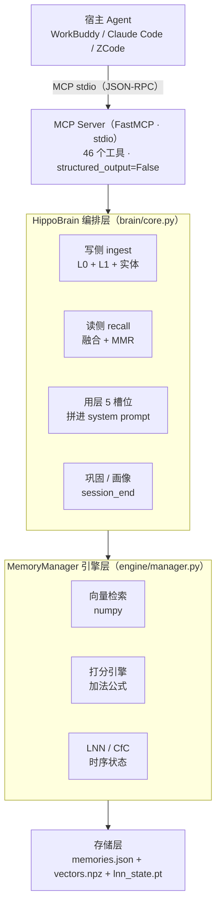
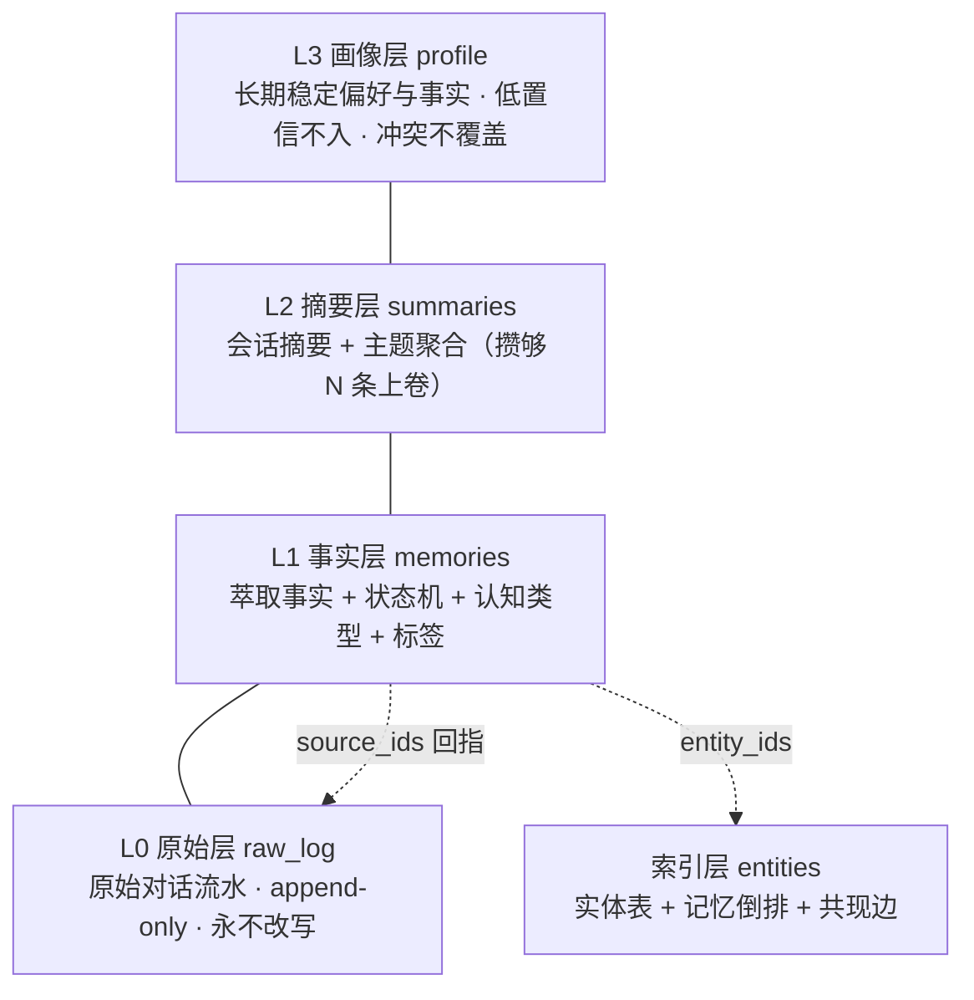
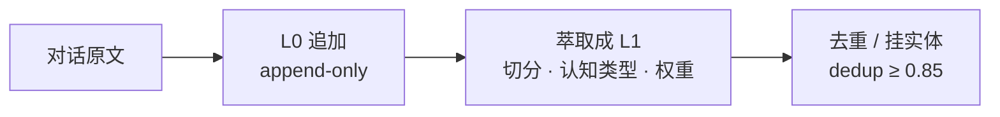
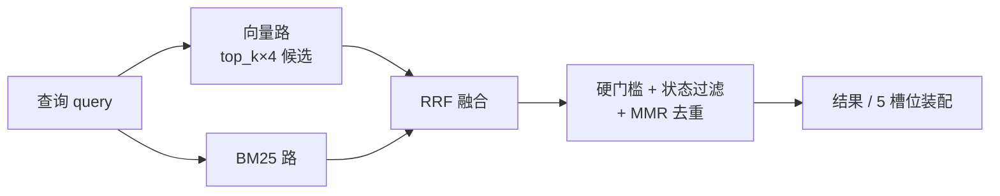
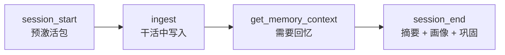

# HippoMCP 架构总览

> 智能体的记忆底座 ｜ 对照 `src/hippocampus_mcp/` 实际代码
> 相关联文档：[`README.md`](../README.md)（安装 / 宿主接入 / 工具面 / 评测口径）

---

## 一、定位

**HippoMCP 不是另一个 Agent 框架，而是智能体大脑里缺失的"存储部分"。**

宿主（WorkBuddy / Claude Code / ZCode / 自研 Agent / 应用）负责推理与行动，
HippoMCP 通过 MCP 协议负责四件事：**记住、想起、整理、以及把当下最该想起的东西按槽位递上去**。

对标 Mem0，但战场划分不同——Mem0 的竞争点在"存 + 搜"，HippoMCP 的差异化在**用层**
（会话生命周期、预激活、纠错级联、巩固与画像）。检索分数追平对手很难，用层体验目前没人做。

---

## 二、分层架构



**为什么分层**：`server.py` 只做协议适配与参数校验，`brain/core.py` 承担全部业务语义
（分层、萃取、融合、状态机），`engine/manager.py` 保持"向量 / 时序 / 打分"的纯工程职责。
这样换宿主不需要动业务，换检索策略不需要动协议。

---

## 三、存储模型：四层记忆 + 索引层



| 层 | 内容 | 关键约束 |
|---|---|---|
| **L3 画像** | 长期偏好 / 稳定事实 | 低置信不入；冲突只提示不覆盖 |
| **L2 摘要** | 会话摘要 | **不入检索路径**：写完只在开场显示最近 2–3 条，即沉睡 |
| **L2T 主题** | L1 事实的**派生聚类**：知识点骨架 + 成员 + 代表句 | **不进 `recall`**（实测教训：摘要类内容进检索把 F1 从 .311 打到 .200）；出口＝`knowledge_map`（列结构）/ `knowledge_topic`（读写单个知识点）工具与开场 `block_knowledge` 槽 |
| **L1 事实** | 萃取事实 + 状态机 + 认知类型 + 结构化标签 | 检索主战场 |
| **L0 原始** | 原始对话流水 | append-only，**保证"核对原话"能力，是反幻觉的基础** |
| **索引层** | 实体表 + 实体↔记忆倒排 + 共现边 | P0 实体图的前身 |

### L1 上的三个枚举

```python
MemoryState    active / superseded / archived      # 生命周期
CognitiveType  experience / world / opinion        # 认识论来源，引用时区别对待
MemoryType     episodic / semantic / procedural / general
```

- **`superseded` 不删除**——事实被取代时标记并指向取代者，时序类与知识更新类问题直接受益。
- **`importance >= 0.7` 自动 `pin`**——豁免时间衰减。

### 层间关系（删改的硬约束）

> **L2 / L2T 主题 / L3 / 索引层都是 L1 的派生副本。只删 L1 等于假删除。**
>
> 主题层（L2T）落在 `brain_knowledge.json`，由 `src/hippocampus_mcp/domain/topic.py` 计算：受信任实体锚点 + 余弦凝聚（leader 型贪心扫描，O(n·k) 而非 O(n²)，质心增量维护、**不存质心**）。它回答的是「这个库有哪些知识点」——L1 平铺、L2 只有会话摘要、L3 是热点条目，没有其他工具能回答这个问题。代表句是**抽取式摘录**（离质心最近的几条原文），**不是归纳**：归纳需要智能，而生产路径不内嵌 LLM，由宿主完成后写回。

- 只从 L1 物理删除 → 画像里的错误文字仍会拼进上下文，实体倒排留下悬挂引用。
- 唯一合法入口是 `brain.forget(id, reason)`，级联 6 步：实体倒排 → 画像层 →
  被取代者恢复 → L0 来源标记 → 墓碑 → 重算实体统计。
- `mention_count ≡ len(memory_ids)`，加载后全量重算，防历史脏数据虚高。

---

## 四、写入链路（ingest）



- **去重合并语义**：相似度 ≥ `dedup_threshold`（默认 0.85）时**不新建**，合并进那条**仍为 active** 的记忆
  —— `content` 取更长者、`timestamp` 取最新、`importance` 取最大、
  `source_ids` / `entity_ids` 取**并集**、`pin` 与 `importance` 同步。
- 候选是 `superseded` / `archived` 时**改为新建**——否则新内容一进来就被状态过滤隐身。
- `ingest_batch`：逐项错误隔离，批内不逐条落盘不逐条巩固，上限 `INGEST_BATCH_MAX = 2000`。
- **`ingest` 与 `store_memory` 的区别**：前者原文进 L0、萃取进 L1、自动挂实体；
  后者只裸写 L1 单条，**不产生 L0 溯源、不建实体**。

---

## 五、召回链路（recall / get_memory_context）



### 打分公式（默认 RRF 融合）

```
fused  = Σ_lane  w_lane / (60 + rank_lane)      # 向量路 w=1.0，字面路 w=bm25_weight
score  = fused + 0.1 · vec_score + 0.03 · time_decay + entity_bonus(0.12)
         （× nav_penalty / × pin 折扣，按记录字段）
```

> **尺度警告**：`score` 现在是 RRF 融合分（实测真库约 0.01–0.09），
> **不再是余弦量级**。原始余弦在各条目的 `similarity` 字段里，两者别混用；
> 任何依赖 `score > 0.3` 类阈值的宿主规则必须改用 `similarity`。

### 回退路径（`HIPPOCAMPUS_RECALL_FUSION=0`）

```
score = 0.95 · sim + 0.03 · time_decay − 0.02 · recall_boost
```

> 加法公式在 LoCoMo 上 MRR@5 从 0.042 提升到 0.183（**4.4 倍**）。
> 关键点是**负 recall 权重当多样性惩罚**；乘法公式已弃用。
> 这条公式在 R1 之后只用于回退路径，默认不再走它。

### 融合后的加分与闸门

| 机制 | 参数 | 作用 |
|---|---|---|
| 相关性硬门槛 | `RELEVANCE_HARD_FLOOR = 0.30` | 阻断"摘要层和什么都相似"而霸榜 |
| 实体桥接加成 | `ENTITY_BONUS = 0.12` | 跨越语义鸿沟（向量低但实体对上） |
| 字面豁免 | `MMR_LITERAL_EXEMPT_TOPN = 3` | BM25 前 N 名豁免 MMR，防"带章号那条"被近义项折叠 |
| 导航降权 | `nav_penalty`，默认 1.0 | 默认**不生效**，需导入端显式打标并配折扣 |
| 冲突标注 | `annotate_conflicts` | 打 `conflict_group` / `conflict_with` / `newer`，**只标注不折叠** |

### 两个入口不要混用

| | `get_memory_context`（推荐） | `recall`（底层） |
|---|---|---|
| 检索 | 在 `recall` 之上加槽位编排 + token 预算 | 向量 + BM25(RRF) + MMR + 实体加成 + 硬门槛 |
| 状态过滤 | 过 superseded / archived | **同样过**（固定 `include_superseded=False`，MCP 工具无逃生参数） |
| 用途 | 递给宿主的上下文 | 调试 / 程序化调用 |

> R1（2026-11-06）起两个入口共用 `retrieval/recall_pipeline.run_recall_pipeline`：
> MCP `recall` 经 `RecallService._recall_one`，`brain.recall` 经薄壳；
> 打分、排序、状态过滤逐位一致。差别只在呈现层——MCP 工具把结果
> 适配成 14 键信封并关闭冲突标注。`HIPPOCAMPUS_RECALL_FUSION=0`
> 可回退到旧的加法打分路径（此时上表右列不成立）。
> `include_superseded` 逃生参数只存在于 `brain.recall` / `entity_profile`，
> **不在** MCP `recall` 工具上。
> 已知缺陷：状态过滤发生在候选循环内，而 `fetch_k` 取在过滤**之前**
> ⇒ 作废条目多的库里，有效条数会被作废项挤掉（名额稀释）。

### 5 槽位（用层核心）

`get_memory_context` 不平铺 top-k，而是按固定槽位装配，可直接拼进 system prompt：

| 槽位 | 内容 | 来源 |
|---|---|---|
| `block_1` | 当前任务的直接命中记忆（MMR 去重） | L1 |
| `block_2` | 未决问题 / 待办意图（≤5） | WorkMemory |
| `block_3` | 时间线位置：最近会话摘要 | L2 |
| `block_4` | 相关实体状态（实体→事实） | 索引层 |
| `block_5` | 上次结论 / 未完结话题 | SessionState |

> **`block_4` 有独立预算**，不随 `top_k` 膨胀（`BLOCK4_MAX_ENTITIES=3` / 每实体 3 条 / 全块 400 字符）。
> 原因：上下文越多，模型越不敢答。

---

## 六、会话生命周期



---

## 七、技术栈

| 层 | 技术 | 说明 |
|---|---|---|
| 协议 | **MCP** + FastMCP SDK | stdio + JSON-RPC，46 个工具 |
| 稠密检索 | sentence-transformers | 默认 `all-MiniLM-L6-v2`（384D，**英文评测口径**）；中文用 `BAAI/bge-base-zh-v1.5`（768D） |
| 稀疏检索 | **自研 BM25 + RRF** | 补向量的字面盲区（章号、数额、专名） |
| 时序编码 | **ncps CfC**（闭式连续时间）+ AutoNCP | 隐式查询向量，HippoMCP 的差异项 |
| 向量库 | **自研 numpy VectorStore** | 分块 matmul 余弦；**唯一受支持后端**，传其他值显式报错 |
| 重排去重 | MMR（带字面豁免） | 检索失败往往是重排问题而非召回问题 |
| 实体抽取 | spaCy（英文）+ 启发式 / 词库（中文） | CJK 跳过 spaCy |
| 持久化 | JSON + npz + pt 三分离 | 带滚动备份与损坏隔离 |
| 评测 | LoCoMo `locomo10` | LLM-as-judge |

### 嵌入器协议（四件套，强制）

```
embed(text)         文档侧（写入时用）
embed_query(text)   查询侧（召回一律走它，BGE 在此加指令前缀）
embed_batch(texts)  批量
model_key           多模型向量库的槽位键
```

`create_embedder()` 强制校验，缺任一方法在**初始化期**抛 `TypeError`，而不是等召回才炸。

---

## 八、关键工程约束（会做错事的部分）

1. **模型解析唯一真相源** `embeddings.resolve_embedder_model()`（参数 > env > 默认）。
   "静默回落 MiniLM"是**默认参数问题**，不是异常兜底。别处不许抄 env 字面量。
2. **模型跟随库内数据**：不符 + 显式指定 → 报错；不符 + 默认 → 跟随库内模型。
   `reembed.py` 是**唯一合法换模型入口**。
3. **向量与本体解耦**：`MemoryRecord.embeddings: dict[model_key, vec]`，旧向量归 `__legacy__`。
   删掉 `.npz` 不会丢记忆。
4. **时间基准必须 `_reference_time or time.time()`**：裸 `time.time()` 会让老记忆
   永久豁免归档，机制反向失效。
5. **`recall_count` 记候选集，`last_recalled_at` 记结果集**——否则沉寂归档被稀释成
   "每次查询给十来条记录续命"。
6. **46 个工具必须带 `structured_output=False`**：否则返回双份。stdout 是协议通道，
   **所有日志必须走 stderr**。
7. **过滤必须在检索前**：`search(allow_ids=)` 用 `-inf` 屏蔽白名单外；**BM25 路必须显式过滤**，
   否则字面命中会绕过。
8. **跨进程写同一目录：默认"冲突即合并"**。脏集重放，脏集只在完全写成功后清空。
   逃逸舱 `MULTI_WRITER=0`（报错）/ `ALLOW_STALE_SAVE=1`（强制覆盖）。
9. **预热等待必须有界**：`HIPPOCAMPUS_WARMUP_TIMEOUT` 默认 90s，**必须 < 宿主 120s**。
   超预算抛 `WarmupPendingError`，失败抛 `WarmupFailedError`（不伪装成超时）。
10. **顶层导入不得引入重库**：`TYPE_CHECKING` + 惰性 `_brain_class()`。
    torch 可在事件循环后导入，**scipy 不行**。
11. **改 `store/memory.py` 后必须同步 `store/__init__.py`**。
12. **写文件后必须回读**：仓库换行符是混合的（`src/store/*.py` 全 LF、`src/*.py` 多为 CRLF），
    替换前先探测，别假设。

---

## 九、评测现状与瓶颈

| 版本 | F1 | mrr3 | hit3 | 说明 |
|---|---:|---:|---:|---|
| V9 纯向量+白化+BM25 | .286 | .287 | .350 | 检索指标最好 |
| V9b +Rerank5 | .295 | .212 | .275 | rerank 提 F1、**损检索** |
| V9c +NER1.1 | .303 | .212 | .275 | |
| **V9d +Rerank10+NER1.2** | **.311** | .221 | .300 | 当前最优 |
| V9e Rerank15 | .277 | .221 | .300 | 过犹不及 |
| **V9f 实体图+2跳扩散** | **.200** | .050 | .050 | **灾难** |

**V9d 分类 F1**：单跳 .357 / 对抗 1.0 / 时序 .116 / **多跳 .081** / **开放域 0.0**

### ⚠️ 三条必须写在明面上的诚实声明

1. **评测口径非标准**：只用了 `locomo10` 的 **50 道 QA + 40 道检索**，
   而 Mem0 论文的协议是 **1,540 道题、排除对抗类**。样本量差 30 倍，**不可直接对比**。
2. **"超越 Mem0"是自建口径下的结果**：`Mem0 0.285` 是本地复现值，不是论文值。
   论文中 Mem0 的公开 F1 为单跳 38.72 / 多跳 28.64 / 开放域 47.65 / 时序 48.93
   —— 尤其在**时序**上，本地复现得到 0.000 而论文是 48.93，这个落差必须先解释清楚，
   否则会成为开源后的第一个质疑点。
3. **优势不稳健**：同一配置在 Judge-A 下 +9.1%、Judge-B 下 **−7.2%**（方向反转）。
   **跨模型对比必须先固定 LLM。**

### 已知短板（按优先级）

1. **多跳 .081**（P0）——先复盘 V9f 的失败，再定路线（查询分解 / 两轮迭代检索 / 实体约束重排）
2. **开放域 0.0**——主因在**检索**而非 prompt（10 道里 7 道 evidence 没进 top-3）

---

## 十、代码地图

> 关键文件导览（**非全量**）：每层只列入口与核心文件；完整文件清单以 `src/hippocampus_mcp/` 目录为准。

```
src/hippocampus_mcp/
│
├─ ★ 入口层（扁平，不可再分层）
├── server.py            MCP 工具面（46 个工具）+ 剖面门控 + 预热/等待/单例守卫
├── cli.py               命令行入口
├── launcher.py          共享 daemon 启动器
├── daemon.py            常驻进程（空闲自退）
├── prewarm.py           进程树改写（预热）
├── bridge.py            会话桥接
│
├─ brain/                编排层 HippoBrain（原单文件 brain.py）
│   ├── __init__.py      命名空间再导出，包外 `from ..brain import X` 一行未改
│   ├── core.py          主类：分层 / 萃取 / 融合 / 状态机 / 巩固
│   ├── pure.py          无状态 mixin（打分公式、块渲染）
│   ├── entity.py        实体词典与别名归一
│   └── session.py       会话续接与开场包
│
├─ engine/               引擎层
│   ├── manager.py       MemoryManager：向量 + 时序 + 打分
│   ├── embeddings.py    嵌入器（四件套协议 + 模型解析唯一真相源）
│   ├── onnx_embedder.py ONNX 后端
│   ├── model_lifecycle.py  模型租约与空闲卸载
│   └── model_cache.py   模型缓存自省与回收（`models` 子命令的后端）
│
├─ map/                  信息地图层（状态寄存器）
│   ├── store.py         地图存储
│   ├── auto.py          自动校验
│   ├── mention.py       提及漂移
│   ├── file_registry.py 项目文件建档（签名比对）
│   └── constants.py     地图层阈值
│
├─ domain/               纯领域逻辑（零包内依赖，可单测）
│   ├── topic.py         主题层 L2T：聚类 / 成员维护 / 抽取式代表句 / 覆盖统计
│   ├── aliases.py       实体别名发现（四条领域无关信号 + 两轮扫）
│   ├── tagging.py       可配置标签抽取器（后缀 → 族 → 键名 两层映射）
│   └── long_content.py  超长内容策略：三态白名单解析 + 分句/硬切计划
│
├─ library/              多库
│   ├── __init__.py      库发现与路径解析（原 library.py）
│   └── registry.py      进程内库注册表
│
├─ common/               最底层（只依赖标准库）
│   ├── constants.py     全局阈值 + 无状态纯函数
│   ├── sidecar_lock.py  侧车并发锁
│   └── session_ctx.py   会话级上下文
│
├─ store/                存储后端
│   ├── memory.py        MemoryRecord 数据模型（多模型向量字典）
│   ├── vector_store.py  numpy 向量索引 + JSON/npz 分离持久化
│   └── backend.py       JSON / SQLite 双后端（按目录内容判定）
│
├─ retrieval/
│   ├── bm25.py          BM25 + RRF 融合
│   ├── scoring.py       打分引擎（加法 / 乘法两模式）
│   ├── sampler.py       距离加权抽样
│   └── intent.py        意图路由
│
├─ lnn/                  CfC 时序记忆核
│   ├── memory_core.py   CfC 动态记忆核
│   ├── numpy_cfc.py     numpy 前向（无 torch 也能跑）
│   ├── projector.py     维度投影
│   ├── checkpoint.py    检查点（原子写 + 备份 + 损坏隔离）
│   └── pt_migrate.py    旧 torch 权重迁移
│
└─ benchmarks/           评测框架（LoCoMo 加载 / 指标 / 多基线）

scripts/    维护脚本扁平命名空间（见「`scripts/` 保持扁平」一节的完整清单）
docs/       ARCHITECTURE.md（本文）与 README 配图
```

> ❗ 不支持 ChromaDB 等第三方向量库后端：实测该路径会静默损坏数据，
> 拒绝原因保留在 `MemoryManager` 的错误信息里。

### ⚠️ 入口层为什么不平摊进子包

`python -m hippocampus_mcp.{cli,server,launcher,daemon,prewarm}` 这些**字符串**
被外部配置写死 —— `mcp.json` 的 `command`/`args`、各宿主的启动脚本、
用户已经粘贴进配置里的整段 JSON 都是这个形式。把它们搬进子目录等于
**让所有现存用户的 MCP 配置在一次升级后同时失效**，而且失败现象是
"连接器连不上"，不会指向 import 错误。

所以根层的 6 个 `.py` 是**契约层**，只允许改内部实现，不允许改路径。
同理 `brain/__init__.py` 用命名空间再导出（`from .core import *`）兜住
包外 67 处 `from ..brain import XXX`，让分层成为**纯内部重构**。

### ⚠️ 改常量要改到 `brain/core.py`，不是 `brain/__init__.py`

`brain/__init__.py` 只是**再导出**，不是定义。`brain.LEDGER_RING = v` 改的是
包的属性副本，`core.py` 内的函数读自己的模块全局，**看不到这次赋值**。
测试 monkeypatch 与线上调参都必须写 `brain.core.LEDGER_RING`。

### ⚠️ `scripts/` 保持扁平

公开的维护脚本保持扁平命名空间，角色由文件名自解释：

| 脚本 | 角色 |
|---|---|
| `reembed.py` | 换嵌入模型入口：查看 / 补齐 / 认领 / 裁剪多模型向量（不重切片、不重导入） |
| `import_md.py` | Markdown 文档批量导入（切片 / 结构化标签 / 断点续跑 / 幂等） |
| `demo_brain.py` | 核心能力演示 |
| `mcp_smoke.py` | MCP 协议冒烟 |
| `verify_onnx.py` | ONNX 后端验证 |
| `verify_install_e2e.py` | 安装链路端到端验收（CI 引用） |
| `judge_client.py` | 评测 LLM-as-judge 客户端 |
| `run_all_tests.py` | 回归唯一入口（跑 `tests/` 全量，CI 与本地都用它） |

唯一的共用模块是 `_lib_access.py`（库目录判定 / 读取的统一入口，后端无关；
`reembed.py` 硬依赖它），其余脚本彼此独立。

---

## 十一、环境变量

| 变量 | 默认 | 说明 |
|---|---|---|
| `HIPPOCAMPUS_PERSIST_DIR` | `~/.hippocampus_mcp` | 记忆持久化目录 |
| `HIPPOCAMPUS_EMB_MODEL` | 按系统语言自动 | 嵌入模型。未设时中文系统用 `BAAI/bge-base-zh-v1.5`（768D），其余用 `all-MiniLM-L6-v2`（384D）；显式设值完全以它为准，且老库仍自动跟随库内已有模型 |
| `HIPPOCAMPUS_EMB_MODEL_AUTO` | `1` | 0/false/off/no = 关掉按系统语言自动选型，恒用 `all-MiniLM-L6-v2` |
| `HIPPOCAMPUS_WARMUP` | `auto` | `auto` / `off` / `sync`（sync 是历史故障档） |
| `HIPPOCAMPUS_WARMUP_TIMEOUT` | `90` | 秒，**必须 < 宿主 120s** |
| `HIPPOCAMPUS_PRELOAD` | `scipy.special,scipy.interpolate` | 预载模块；`full` 会超宿主窗口 |
| `HIPPOCAMPUS_LAMBDA_DECAY` | `7776000` | 时间衰减常数（90 天） |
| `HIPPOCAMPUS_W_SIM/W_TIME/W_RECALL` | `0.95/0.03/-0.02` | 加法评分权重 |
| `HIPPOCAMPUS_MULTI_WRITER` | `1` | 0 = 冲突报错 |
| `HIPPOCAMPUS_TAG_SCHEMA` | 空 | 标签 schema 路径（优先级：显式 > env > persist_dir > 内置） |
| `HF_HUB_OFFLINE` / `TRANSFORMERS_OFFLINE` | 未设 | 生产建议设 1（需模型已缓存） |
