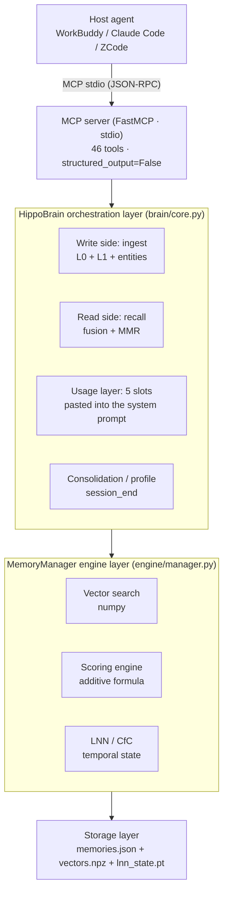
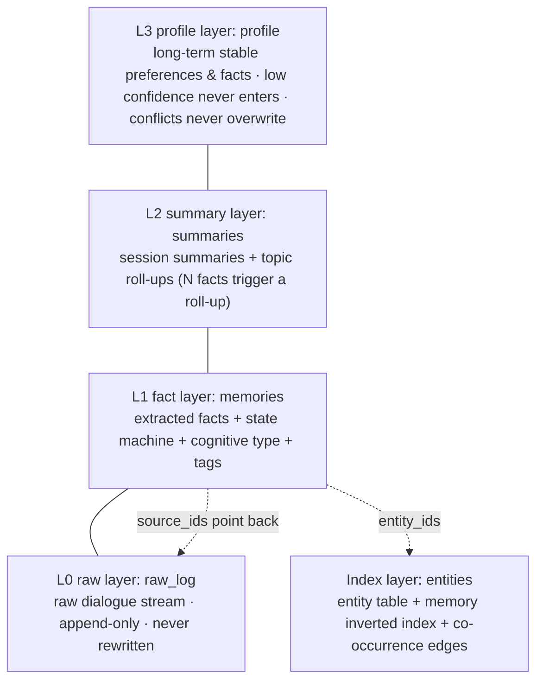
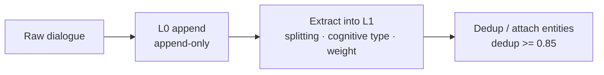
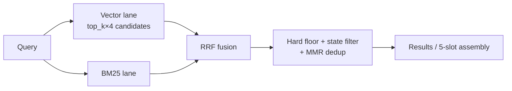
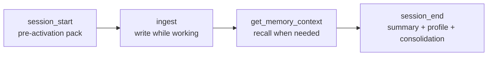

# HippoMCP Architecture

> The memory substrate for agents ｜ Mirrors the actual code under `src/hippocampus_mcp/`
> Related: [`README.md`](../README.md) (installation / host integration / tool surface / evaluation)
> 🌐 中文版：[ARCHITECTURE.zh-CN.md](ARCHITECTURE.zh-CN.md) — the English edition below is the maintenance trunk.

---

## Contents

1. [Positioning](#1-positioning)
2. [Layered architecture](#2-layered-architecture)
3. [Storage model: four memory layers + index layer](#3-storage-model-four-memory-layers--index-layer)
4. [Write path (ingest)](#4-write-path-ingest)
5. [Recall path (recall / get_memory_context)](#5-recall-path-recall--get_memory_context)
6. [Session lifecycle](#6-session-lifecycle)
7. [Tech stack](#7-tech-stack)
8. [Critical engineering constraints (where mistakes happen)](#8-critical-engineering-constraints-where-mistakes-happen)
9. [Evaluation status and bottlenecks](#9-evaluation-status-and-bottlenecks)
10. [Code map](#10-code-map)
11. [Environment variables](#11-environment-variables)

---

## 1. Positioning

**HippoMCP is not another agent framework — it is the missing "storage part" of an agent's brain.**

The host (WorkBuddy / Claude Code / ZCode / your own agent / an application) handles reasoning and
acting. HippoMCP, over the MCP protocol, does four things: **remember, recall, tidy up, and hand
up — by slot — exactly what should be recalled right now**.

It benchmarks against Mem0 with a different battlefield split: Mem0 competes on "store + search",
while HippoMCP differentiates on the **usage layer** (session lifecycle, pre-activation,
correction cascades, consolidation and profile). Matching a rival's retrieval scores is hard;
nobody is yet competing on the usage-layer experience.

---

## 2. Layered architecture



**Why layers**: `server.py` only adapts the protocol and validates parameters; `brain/core.py`
carries all business semantics (layering, extraction, fusion, state machines);
`engine/manager.py` keeps the pure engineering duties of "vectors / time / scoring".
Swapping hosts then never touches business logic, and swapping retrieval strategy never
touches the protocol.

---

## 3. Storage model: four memory layers + index layer



| Layer | Content | Key constraint |
|---|---|---|
| **L3 profile** | long-term preferences / stable facts | low confidence never enters; conflicts only surface, never overwrite |
| **L2 summary** | session summaries | **not in the retrieval path**: after a write, only the latest 2–3 show in the opening pack, then it sleeps |
| **L2T topic** | **derived clustering** of L1 facts: knowledge skeleton + members + representative sentences | **never in `recall`** (measured lesson: summaries in retrieval dropped F1 from .311 to .200); exits = the `knowledge_map` (list structure) / `knowledge_topic` (read/write one topic) tools and the opening pack's `block_knowledge` slot |
| **L1 fact** | extracted facts + state machine + cognitive type + structured tags | the main battleground of retrieval |
| **L0 raw** | raw dialogue stream | append-only; **guarantees the "check the original words" ability — the foundation of anti-hallucination** |
| **index** | entity table + entity↔memory inverted index + co-occurrence edges | forerunner of the P0 entity graph |

### Three enums on L1

```python
MemoryState    active / superseded / archived      # lifecycle
CognitiveType  experience / world / opinion        # epistemic origin; treat citations differently
MemoryType     episodic / semantic / procedural / general
```

- **`superseded` is never deleted** — when a fact is replaced it is flagged and points at its
  successor; temporal questions and knowledge-update questions benefit directly.
- **`importance >= 0.7` auto-`pin`s** — exempt from time decay.

### Cross-layer relations (hard constraints on deletion/editing)

> **L2 / L2T topics / L3 / the index layer are all derived copies of L1. Deleting L1 alone is a
> fake delete.**
>
> The topic layer (L2T) lives in `brain_knowledge.json`, computed by
> `src/hippocampus_mcp/domain/topic.py`: trusted entity anchors + cosine leader clustering
> (leader-style greedy scan, O(n·k) rather than O(n²), incremental centroid maintenance,
> **centroids are not stored**). It answers "what knowledge topics does this library have" —
> L1 is flat, L2 only has session summaries, L3 is hot entries; no other tool answers this.
> Representative sentences are **extractive quotes** (the originals closest to the centroid),
> **not abstractions**: abstraction needs intelligence, and the production path embeds no LLM —
> the host does it and writes the result back.

- Physically deleting only from L1 → wrong profile text still gets assembled into context, and
  the entity inverted index keeps dangling references.
- The only legal entry is `brain.forget(id, reason)`, cascading 6 steps: entity inverted index →
  profile layer → revive superseded entries → L0 source flagging → tombstones → recompute entity stats.
- `mention_count ≡ len(memory_ids)`, fully recomputed on load, so historical dirty data cannot inflate it.

---

## 4. Write path (ingest)



- **Dedup merge semantics**: at similarity >= `dedup_threshold` (default 0.85) a new record is
  **not** created; content merges into the matching memory that is **still active** —
  `content` takes the longer, `timestamp` the newest, `importance` the max,
  `source_ids` / `entity_ids` the **union**, and `pin` stays in sync with `importance`.
- When the candidate is `superseded` / `archived`, **create new instead** — otherwise the new
  content would be invisible the moment it lands, hidden by the state filter.
- `ingest_batch`: per-item error isolation; no per-item persistence or per-item consolidation
  within the batch; cap `INGEST_BATCH_MAX = 2000`.
- **`ingest` vs `store_memory`**: the former sends the raw text to L0, extracts into L1, and
  attaches entities automatically; the latter writes one bare L1 record — **no L0 provenance,
  no entities**.

---

## 5. Recall path (recall / get_memory_context)



### Scoring formula (RRF fusion, the default)

```
fused  = Σ_lane  w_lane / (60 + rank_lane)      # vector lane w=1.0, literal lane w=bm25_weight
score  = fused + 0.1 · vec_score + 0.03 · time_decay + entity_bonus(0.12)
         (× nav_penalty / × pin discount, per record fields)
```

> **Scale warning**: `score` is now an RRF fusion score (measured ~0.01–0.09 on a real library)
> and is **no longer cosine-magnitude**. The raw cosine lives in each entry's `similarity`
> field; do not mix the two. Any host rule that thresholds on `score > 0.3`-style values must
> switch to `similarity`.

### Fallback path (`HIPPOCAMPUS_RECALL_FUSION=0`)

```
score = 0.95 · sim + 0.03 · time_decay − 0.02 · recall_boost
```

> The additive formula lifted MRR@5 from 0.042 to 0.183 on LoCoMo (**4.4×**).
> The key is the **negative recall weight acting as a diversity penalty**; the multiplicative
> formula is deprecated. After R1 this formula is fallback-only — the default path no longer
> uses it.

### Post-fusion boosts and gates

| Mechanism | Parameter | Effect |
|---|---|---|
| Relevance hard floor | `RELEVANCE_HARD_FLOOR = 0.30` | blocks "the summary layer is similar to everything" from dominating |
| Entity-bridge boost | `ENTITY_BONUS = 0.12` | crosses the semantic gap (low vector, right entity) |
| Literal exemption | `MMR_LITERAL_EXEMPT_TOPN = 3` | exempts BM25's top N from MMR, so "the entry with the chapter number" is not folded away by near-synonyms |
| Navigation down-weight | `nav_penalty`, default 1.0 | **inert by default**; requires the ingest side to tag explicitly plus a configured discount |
| Conflict annotation | `annotate_conflicts` | adds `conflict_group` / `conflict_with` / `newer` — **annotates only, never folds** |

### Do not mix the two entries

| | `get_memory_context` (recommended) | `recall` (low level) |
|---|---|---|
| Retrieval | slot orchestration + token budget on top of `recall` | vector + BM25 (RRF) + MMR + entity boost + hard floor |
| State filter | filters superseded / archived | **the same** (fixed `include_superseded=False`; the MCP tool has no escape parameter) |
| Use | context handed to the host | debugging / programmatic calls |

> Since R1 (2026-11-06) both entries share `retrieval/recall_pipeline.run_recall_pipeline`:
> the MCP `recall` goes through `RecallService._recall_one`, `brain.recall` through a thin
> shell; scoring, ordering and state filtering are identical bit for bit. The difference is
> presentation only — the MCP tool adapts results into a 14-key envelope and switches conflict
> annotation off. `HIPPOCAMPUS_RECALL_FUSION=0` falls back to the old additive scoring path
> (which voids the right column above). The `include_superseded` escape parameter exists only
> on `brain.recall` / `entity_profile`, **not** on the MCP `recall` tool.
> Known defect: state filtering happens inside the candidate loop while `fetch_k` is taken
> **before** filtering ⇒ in libraries with many superseded entries, live entries get crowded
> out of the quota (quota dilution).

### The 5 slots (core of the usage layer)

`get_memory_context` does not flatten a top-k; it assembles fixed slots, ready to paste into a
system prompt:

| Slot | Content | Source |
|---|---|---|
| `block_1` | direct hits for the current task (MMR-deduped) | L1 |
| `block_2` | open questions / pending intents (≤5) | WorkMemory |
| `block_3` | timeline position: recent session summaries | L2 |
| `block_4` | related entity states (entity → facts) | index layer |
| `block_5` | last conclusions / unfinished topics | SessionState |

> **`block_4` has its own budget** and does not grow with `top_k`
> (`BLOCK4_MAX_ENTITIES=3` / 3 entries per entity / 400 characters for the block).
> Reason: the more context you stuff in, the less the model dares to answer.

---

## 6. Session lifecycle



---

## 7. Tech stack

| Layer | Technology | Notes |
|---|---|---|
| Protocol | **MCP** + FastMCP SDK | stdio + JSON-RPC, 46 tools |
| Dense retrieval | sentence-transformers | default `all-MiniLM-L6-v2` (384D, **English evaluation setup**); for Chinese `BAAI/bge-base-zh-v1.5` (768D) |
| Sparse retrieval | **in-house BM25 + RRF** | covers the vector lane's literal blind spots (chapter numbers, amounts, proper names) |
| Temporal encoding | **ncps CfC** (closed-form continuous time), pure-numpy AutoNCP | **experimental, off by default**: the CfC is untrained in production, so its query blend is disabled (`use_lnn` defaults to false) |
| Vector store | **in-house numpy VectorStore** | blocked matmul cosine; **the only supported backend** — any other value fails loudly |
| Rerank/dedup | MMR (with literal exemption) | retrieval failure is usually a reranking problem, not a recall problem |
| Entity extraction | spaCy (English) + heuristics / lexicon (Chinese) | CJK skips spaCy |
| Persistence | JSON + npz + pt, three-way split | with rolling backups and corruption isolation |
| Evaluation | LoCoMo `locomo10` | LLM-as-judge |

### The embedder protocol (four pieces, enforced)

```
embed(text)         document side (used on write)
embed_query(text)   query side (all recall goes through it; BGE adds its instruction prefix here)
embed_batch(texts)  batch
model_key           slot key of the multi-model vector store
```

`create_embedder()` validates strictly: a missing method raises `TypeError` **at
initialization**, not at first recall.

---

## 8. Critical engineering constraints (where mistakes happen)

1. **Single source of truth for model resolution**: `embeddings.resolve_embedder_model()`
   (parameter > env > default). "Silently falling back to MiniLM" is a **default-parameter
   problem**, not an exception fallback. No copying env literals elsewhere.
2. **The model follows the data inside the library**: mismatch + explicit request → error;
   mismatch + default → follow the library's model. `reembed.py` is **the only legal
   model-swap entry**.
3. **Vectors decoupled from the record**: `MemoryRecord.embeddings: dict[model_key, vec]`,
   old vectors land in `__legacy__`. Deleting the `.npz` never loses memories.
4. **Time base must be `_reference_time or time.time()`**: bare `time.time()` grants old
   memories a permanent dormancy exemption — the mechanism silently inverts.
5. **`recall_count` counts the candidate set, `last_recalled_at` the result set** — otherwise
   dormancy archiving gets diluted into "every query grants a dozen records a life extension".
6. **All 46 tools must carry `structured_output=False`**: otherwise responses double. stdout is
   the protocol channel — **all logging must go to stderr**.
7. **Filter before retrieval**: `search(allow_ids=)` masks non-whitelisted ids with `-inf`;
   **the BM25 lane must filter explicitly**, otherwise literal hits bypass it.
8. **Cross-process writes to one directory: "conflict means merge" by default**. Dirty sets
   replay, and clear only after a fully successful write. Escape hatches: `MULTI_WRITER=0`
   (error out) / `ALLOW_STALE_SAVE=1` (force overwrite).
9. **Warmup waits must be bounded**: `HIPPOCAMPUS_WARMUP_TIMEOUT` defaults to 90s and **must
   stay < the host's 120s**. Over-budget raises `WarmupPendingError`; failure raises
   `WarmupFailedError` (never disguised as a timeout).
10. **Top-level imports must not pull heavy libraries**: `TYPE_CHECKING` + a lazy
    `_brain_class()`. torch may be imported after the event loop starts; **scipy may not**.
11. **After changing `store/memory.py`, sync `store/__init__.py`**.
12. **Read back after writing files**: this repo's line endings are mixed (`src/store/*.py`
    all LF; `src/*.py` mostly CRLF) — probe before replacing, never assume.

---

## 9. Evaluation status and bottlenecks

| Version | F1 | mrr3 | hit3 | Notes |
|---|---:|---:|---:|---|
| V9 pure vector + whitening + BM25 | .286 | .287 | .350 | best retrieval metrics |
| V9b +Rerank5 | .295 | .212 | .275 | rerank lifts F1, **hurts retrieval** |
| V9c +NER1.1 | .303 | .212 | .275 | |
| **V9d +Rerank10+NER1.2** | **.311** | .221 | .300 | historical best — **not** the current baseline |
| V9e Rerank15 | .277 | .221 | .300 | too much of a good thing |
| **V9f entity graph + 2-hop diffusion** | **.200** | .050 | .050 | **disaster** |

**V9d per-class F1**: single-hop .357 / adversarial 1.0 / temporal .116 / **multi-hop .081** /
**open-domain 0.0**

> ⚠️ **This table is a historical experiment log, not the current score.** These configurations
> were measured under a judge environment that no longer exists. They are kept for the
> engineering post-mortem (the V9e / V9f regressions) and **must not be cited as current
> performance — in docs, READMEs, or public posts**. The current measured baseline, with its
> conditions, is [`BENCHMARKS.md`](BENCHMARKS.md) §1 (`F1 = 0.244 ± 0.034`, 50 QA, three runs,
> `glm-5.3-flash`). The historical driver is not published: neither number is a one-command
> reproduction claim. Cross-project comparison requires the same dataset, protocol, question
> count, and judge.

### ⚠️ Three honesty statements that must stay in the open

1. **The evaluation setup is non-standard**: it uses only `locomo10`'s **50 QA + 40 retrieval**
   items, while the Mem0 paper's protocol is **1,540 questions with adversarial excluded**.
   A 30× sample-size gap — **the numbers are not directly comparable**.
2. **"Beats Mem0" was an internal measurement, not a public comparison claim**: `Mem0 0.285`
   is a locally reproduced value, not the paper's. The paper's published Mem0 F1 is single-hop
   38.72 / multi-hop 28.64 / open-domain 47.65 / temporal 48.93 — in **temporal** especially,
   local reproduction scored 0.000 against the paper's 48.93. This line is an internal
   historical record: **do not cite it externally as evidence of beating Mem0**, and pin the
   judge before any cross-model comparison.
3. **The advantage is not robust**: the same configuration scores +9.1% under Judge-A and
   **−7.2%** under Judge-B (direction flips). **Cross-model comparisons must pin the LLM first.**

### Known shortcomings (by priority)

1. **Multi-hop .081** (P0) — post-mortem the V9f failure first, then pick a route (query
   decomposition / two-pass iterative retrieval / entity-constrained reranking)
2. **Open-domain 0.0** — mostly a **retrieval** problem, not a prompt problem (in 7 of 10
   questions the evidence never reached top-3)

---

## 10. Code map

> A guided tour of key files (**not exhaustive**): each layer lists entries and core files
> only; the full inventory is the `src/hippocampus_mcp/` directory itself.

```
src/hippocampus_mcp/
│
├─ ★ Entry layer (flat; must not be nested deeper)
├── server.py            MCP tool surface (46 tools) + profile gating + warmup/wait/singleton guards
├── cli.py               command-line entry
├── launcher.py          shared daemon launcher
├── daemon.py            resident process (idles out by itself)
├── prewarm.py           process-tree rewrite (warmup)
├── bridge.py            session bridging
│
├─ brain/                orchestration layer HippoBrain (formerly single-file brain.py)
│   ├── __init__.py      namespace re-exports; `from ..brain import X` unchanged outside
│   ├── core.py          main class: layering / extraction / fusion / state machines / consolidation
│   ├── pure.py          stateless mixins (scoring formulas, block rendering)
│   ├── entity.py        entity lexicon and alias normalization
│   └── session.py       session continuation and the opening pack
│
├─ engine/               engine layer
│   ├── manager.py       MemoryManager: vectors + time + scoring
│   ├── embeddings.py    embedders (four-piece protocol + the single source of model resolution)
│   ├── onnx_embedder.py ONNX backend
│   ├── model_lifecycle.py  model leases and idle unloading
│   └── model_cache.py   model-cache introspection and eviction (backend of the `models` subcommand)
│
├─ map/                  information-map layer (state register)
│   ├── store.py         map storage
│   ├── auto.py          automatic verification
│   ├── mention.py       mention drift
│   ├── file_registry.py project file registry (signature comparison)
│   └── constants.py     map-layer thresholds
│
├─ domain/               pure domain logic (zero intra-package dependencies; unit-testable)
│   ├── topic.py         topic layer L2T: clustering / member maintenance / extractive representatives / coverage stats
│   ├── aliases.py       entity alias discovery (four domain-independent signals + two passes)
│   ├── tagging.py       configurable tag extractor (suffix → family → key-name, two-level mapping)
│   └── long_content.py  overlong-content policy: three-state whitelist parsing + split/hard-cut plans
│
├─ library/              multi-library
│   ├── __init__.py      library discovery and path resolution (formerly library.py)
│   └── registry.py      in-process library registry
│
├─ common/               the bottom layer (standard library only)
│   ├── constants.py     global thresholds + stateless pure functions
│   ├── sidecar_lock.py  sidecar concurrency lock
│   └── session_ctx.py   session-scoped context
│
├─ store/                storage backends
│   ├── memory.py        MemoryRecord data model (multi-model vector dict)
│   ├── vector_store.py  numpy vector index + JSON/npz split persistence
│   └── backend.py       JSON / SQLite dual backend (decided by directory contents)
│
├─ retrieval/
│   ├── bm25.py          BM25 + RRF fusion
│   ├── scoring.py       scoring engine (additive / multiplicative modes)
│   ├── sampler.py       distance-weighted sampling
│   └── intent.py        intent routing
│
├─ lnn/                  CfC temporal memory core
│   ├── memory_core.py   CfC dynamic memory core
│   ├── numpy_cfc.py     numpy forward pass (runs without torch)
│   ├── projector.py     dimension projection
│   ├── checkpoint.py    checkpoints (atomic write + backup + corruption isolation)
│   └── pt_migrate.py    legacy torch weight migration
│
└─ benchmarks/           evaluation framework (LoCoMo loading / metrics / multiple baselines)

scripts/    flat namespace of maintenance scripts (see the full list under "scripts/ stays flat")
docs/       ARCHITECTURE.md (this file, English trunk), ARCHITECTURE.zh-CN.md, and README figures
```

> ❗ Third-party vector-store backends such as ChromaDB are not supported: that path was
> measured to silently corrupt data; the reasons live on in `MemoryManager`'s error message.

### ⚠️ Why the entry layer stays flat instead of spreading into subpackages

The **strings** `python -m hippocampus_mcp.{cli,server,launcher,daemon,prewarm}` are baked
into external configuration — the `command`/`args` of `mcp.json`, every host's launch scripts,
and the whole JSON snippets users have already pasted into their setups. Moving them into
subdirectories would **break every existing user's MCP config in a single upgrade**, and the
failure would surface as "connector can't connect", never pointing at the import error.

The 6 root-level `.py` files are therefore a **contract layer**: internal implementations may
change, paths may not. For the same reason `brain/__init__.py` uses namespace re-exports
(`from .core import *`) to shelter the 67 out-of-package `from ..brain import XXX` call sites,
making the layering a **pure internal refactor**.

### ⚠️ Change constants in `brain/core.py`, not `brain/__init__.py`

`brain/__init__.py` **re-exports**; it does not define. `brain.LEDGER_RING = v` assigns the
package's attribute copy, while functions inside `core.py` read their own module globals and
**never see that assignment**. Test monkeypatches and live tuning must write
`brain.core.LEDGER_RING`.

### ⚠️ `scripts/` stays flat

Public maintenance scripts keep a flat namespace; the filename says the role:

| Script | Role |
|---|---|
| `reembed.py` | model-swap entry: inspect / backfill / adopt / prune multi-model vectors (no re-chunking, no re-import) |
| `import_md.py` | bulk Markdown import (chunking / structured tags / resumable / idempotent) |
| `demo_brain.py` | core-capability demo |
| `mcp_smoke.py` | MCP protocol smoke test |
| `verify_onnx.py` | ONNX backend verification |
| `verify_install_e2e.py` | end-to-end install-path acceptance (referenced by CI) |
| `judge_client.py` | evaluation LLM-as-judge client |
| `run_all_tests.py` | the single regression entry (runs all of `tests/`, in CI and locally) |

The only shared module is `_lib_access.py` (the backend-agnostic unified entry for library-dir
detection/reading; `reembed.py` hard-depends on it); every other script stands alone.

---

## 11. Environment variables

| Variable | Default | Notes |
|---|---|---|
| `HIPPOCAMPUS_PERSIST_DIR` | `~/.hippocampus_mcp` | memory persistence directory |
| `HIPPOCAMPUS_EMB_MODEL` | auto by system language | embedding model. Unset: Chinese systems get `BAAI/bge-base-zh-v1.5` (768D), others `all-MiniLM-L6-v2` (384D); an explicit value always wins, and existing libraries still auto-follow the model already in the library |
| `HIPPOCAMPUS_EMB_MODEL_AUTO` | `1` | 0/false/off/no = disable the by-system-language auto-selection, always `all-MiniLM-L6-v2` |
| `HIPPOCAMPUS_WARMUP` | `auto` | `auto` / `off` / `sync` (sync is a historical failure mode) |
| `HIPPOCAMPUS_WARMUP_TIMEOUT` | `90` | seconds; **must stay < the host's 120s** |
| `HIPPOCAMPUS_PRELOAD` | `scipy.special,scipy.interpolate` | preloaded modules; `full` exceeds the host's window |
| `HIPPOCAMPUS_LAMBDA_DECAY` | `7776000` | time-decay constant (90 days) |
| `HIPPOCAMPUS_W_SIM/W_TIME/W_RECALL` | `0.95/0.03/-0.02` | additive-scoring weights |
| `HIPPOCAMPUS_MULTI_WRITER` | `1` | 0 = conflict means error |
| `HIPPOCAMPUS_TAG_SCHEMA` | empty | tag-schema path (priority: explicit > env > persist_dir > built-in) |
| `HF_HUB_OFFLINE` / `TRANSFORMERS_OFFLINE` | unset | set to 1 in production (model must be cached) |
